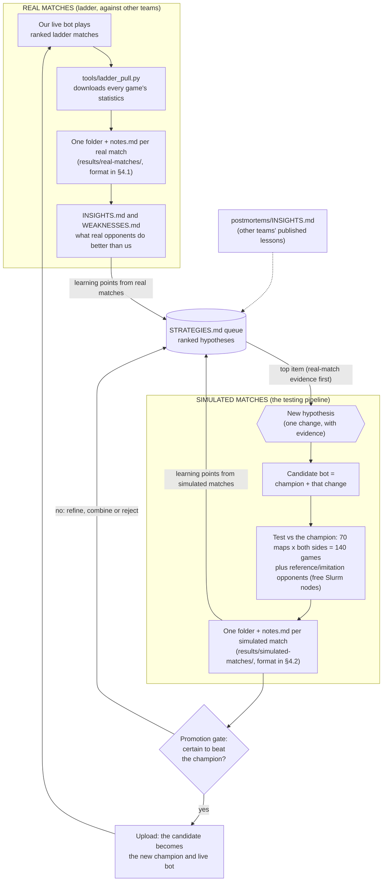
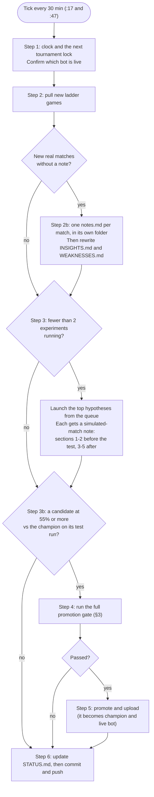
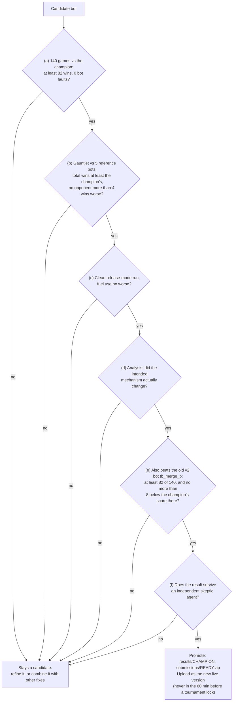
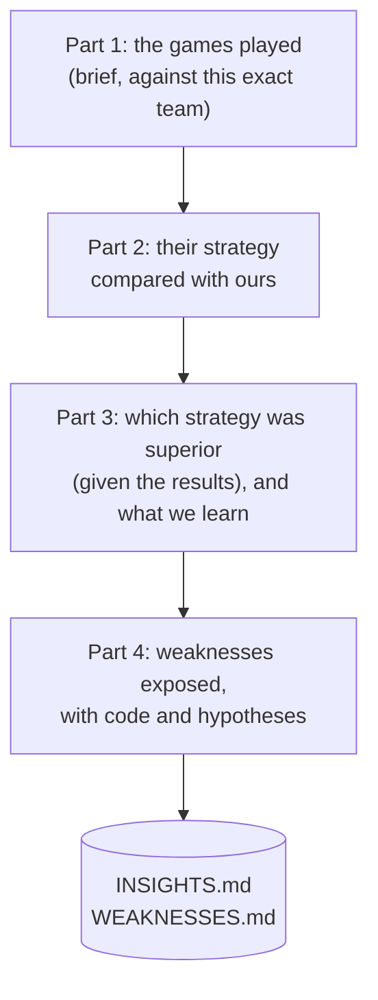
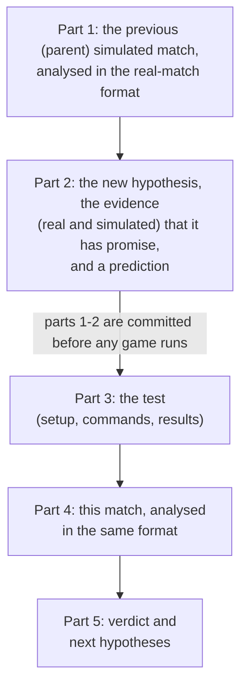
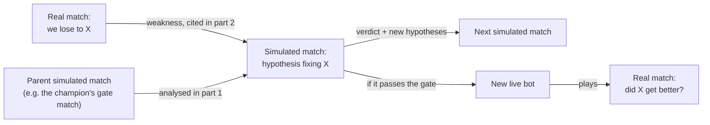

# Cambridge-BattleCode-Turborecallers-2026

Created at: 2026-10-31T18:01:01.099Z
Active markdown file: Cambridge BattleCode Turborecallers 2026.md
Obsidian vault: Obsidian Md Notes

---

Team **Turbo Recallers** in [Cambridge Battlecode 2026a](https://2026a.battlecode.co.uk). An AI agent improves our bot around the clock with two sources of learning:

- **Real matches.** Our live bot plays ranked ladder games against other teams. These are the most valuable evidence.
- **Simulated matches.** Our own bots play each other on free cluster nodes. This is the **testing pipeline**: every idea is tested here before it can go live.

Everything lives in [`ians linux bot/`](ians%20linux%20bot). The rest of this page explains the workflow and where to read the results.

## 1. The improvement loop



In words:
1. Every real match gets a careful note. The notes add up to a ranked list of our weaknesses.
2. Weaknesses from real matches, lessons from earlier simulated matches and other teams' postmortems feed one ranked queue of **hypotheses** in `STRATEGIES.md`. Hypotheses with real-match evidence come first.
3. Each hypothesis is built into a **candidate** bot (the champion plus one change) and tested in simulated matches.
4. A candidate that is **certain** to beat the champion (see §3) is uploaded and becomes the bot playing the ladder. Its real matches then feed step 1 again.

## 2. What happens every 30 minutes (one "tick")



Step numbers match `LOOP.md`. Real-match analysis (step 2b) comes first each tick; simulated experiments keep running alongside.

## 3. The promotion gate (LOOP.md step 4): when does a new bot go live?



(a) uses all 70 maps from both sides; 82/140 is the smallest score whose 95% Wilson lower bound is above 50%. (e) guards against gains that exist only when our bots play each other. The gate's noise was calibrated with "placebo" bots that change nothing. They score 66-68 wins out of 140 against an even 70. So passing at 82 isn't luck. Even so, local wins don't guarantee ladder wins, so the live bot's real record is monitored after every promotion.

## 4. How each note is written

### 4.1 Real-match note: one folder per match (the 5 games against one team)
`ians linux bot/results/real-matches/<YYYY-MM-DD>_<HHMM UTC>_<opponent-slug>_<group8>/notes.md`, where group8 is the first 8 characters of the match-group id ([template](ians%20linux%20bot/results/real-matches/TEMPLATE.md))



### 4.2 Simulated-match note: one folder per test
`ians linux bot/results/simulated-matches/<YYYY-MM-DD>_<HHMM UTC>_<candidate>/notes.md`, created by `tools/new_sim_note.py` when the test is launched ([template](ians%20linux%20bot/results/simulated-matches/TEMPLATE.md))



The notes chain together. Each simulated note starts by analysing its **parent**: the finished simulated match it builds on, usually the current champion's gate match or the experiment it refines. Several experiments can share a parent. Each note also cites the real-match notes behind its hypothesis, and `simulated-matches/INDEX.md` shows every note's parent.



## 5. Where to read things

| What | Where |
|---|---|
| **Insights from real matches** (start here) | [`results/real-matches/INSIGHTS.md`](ians%20linux%20bot/results/real-matches/INSIGHTS.md) |
| Ranked list of our weaknesses | [`results/real-matches/WEAKNESSES.md`](ians%20linux%20bot/results/real-matches/WEAKNESSES.md) |
| Every real match, newest first, with links to the site | [`results/real-matches/INDEX.md`](ians%20linux%20bot/results/real-matches/INDEX.md) |
| Every simulated match (the testing pipeline), in order | [`results/simulated-matches/INDEX.md`](ians%20linux%20bot/results/simulated-matches/INDEX.md) |
| Live bot, its evidence, and the candidates being watched | [`results/READY.md`](ians%20linux%20bot/results/READY.md) |
| What the agent is doing right now | [`results/STATUS.md`](ians%20linux%20bot/results/STATUS.md) |
| Hypothesis queue and every verdict so far | [`results/STRATEGIES.md`](ians%20linux%20bot/results/STRATEGIES.md) |
| Lessons from other teams' published postmortems | [`postmortems/INSIGHTS.md`](ians%20linux%20bot/postmortems/INSIGHTS.md) |
| The detailed operating protocol | [`LOOP.md`](ians%20linux%20bot/LOOP.md) |
| History, lineage and engine facts | [`HANDOFF.md`](ians%20linux%20bot/HANDOFF.md) |

```text
ians linux bot/
├── bots/<name>/src/bot.py        every bot; the champion is named in results/CHAMPION
├── results/
│   ├── real-matches/
│   │   ├── INSIGHTS.md           the readable synthesis (kept short, rewritten each update)
│   │   ├── WEAKNESSES.md         ranked weakness ledger
│   │   ├── INDEX.md              all real matches, with site links
│   │   ├── TEMPLATE.md
│   │   ├── 2026-11-01_0532_team-name_5eca4952/notes.md     one folder per real match
│   │   └── studies/…/notes.md    analyses across many real matches
│   ├── simulated-matches/
│   │   ├── INDEX.md              all simulated matches, oldest first
│   │   ├── TEMPLATE.md
│   │   └── 2026-11-01_0437_c2_respawn/notes.md             one folder per simulated match
│   ├── STATUS.md  READY.md  STRATEGIES.md  CHAMPION
│   └── ladder-games.jsonl        every real ladder game (one line each)
├── tools/                        harness: eval, gauntlet, ladder_pull, scout, organize_notes, onslurm
├── LOOP.md                       the operating protocol
└── HANDOFF.md                    history and engine facts
```

## 6. Glossary

| Term | Meaning |
|---|---|
| Match (real) | The 5 games our live bot plays against one team in one ladder "match group". It gets one folder and one note |
| Match (simulated) | One test of a candidate, usually 140 games against the champion. It gets one folder and one note |
| Champion | Our best validated bot (`results/CHAMPION`). It is also the bot playing the ladder |
| Candidate | The champion plus one change that tests a hypothesis |
| Gate | The checks in §3 that a candidate must pass to become champion |
| Tick | One pass of the loop in §2, every 30 minutes |
| Version (v2, v3, v4, ...) | Our uploads on the site, in order. `results/ladder-versions.json` records when each went live |

## 7. Running it

- The agent runs on the Harvard FASRC cluster. All games run on the free Slurm `test` partition through `tools/onslurm.sh`.
- Setup and the rules for agents are in [`CLAUDE.md`](CLAUDE.md). The step-by-step protocol is in [`LOOP.md`](ians%20linux%20bot/LOOP.md).
- Useful commands, from `ians linux bot/`:
  - `python3.12 tools/ladder_pull.py`: fetch new ladder games and print the record per version.
  - `python3.12 tools/scout.py --group <id>`: profile both teams in a real match.
  - `python3.12 tools/unscouted.py --claim`: list and claim the real matches that still need a note.
  - `python3.12 tools/new_sim_note.py CAND --vs CHAMP --prev PARENT`: start a simulated-match note before its test.
  - `python3.12 tools/organize_notes.py`: tidy the note folders and rebuild both indexes.
  - `tools/onslurm.sh -c 24 -m 16G -t 00:20:00 -J gate -- python3.12 tools/eval.py CAND CHAMP --maps all --jobs 16`: a 140-game head-to-head.
